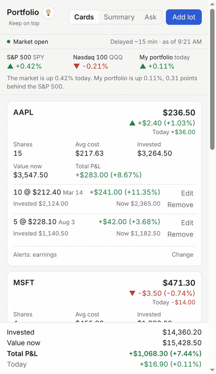
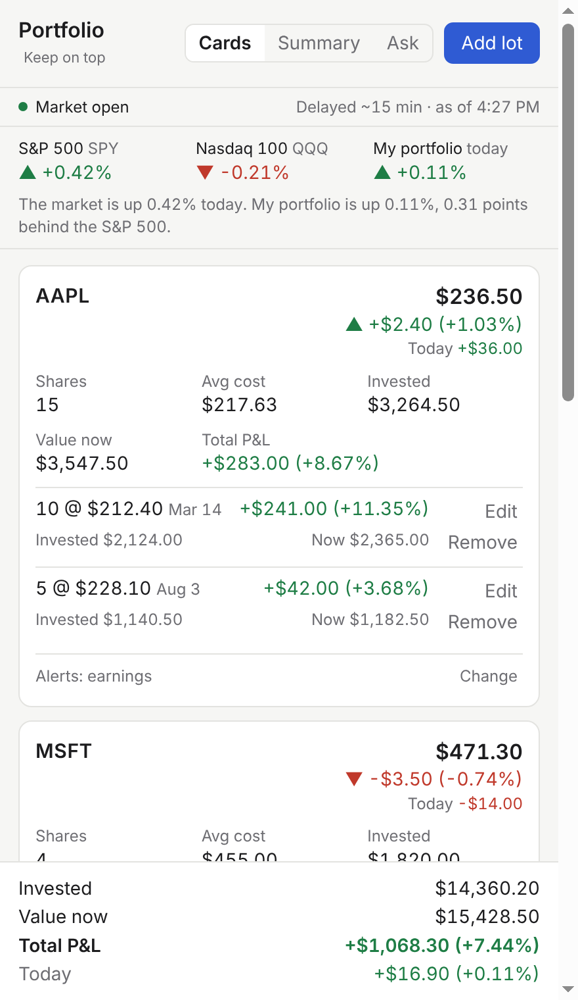
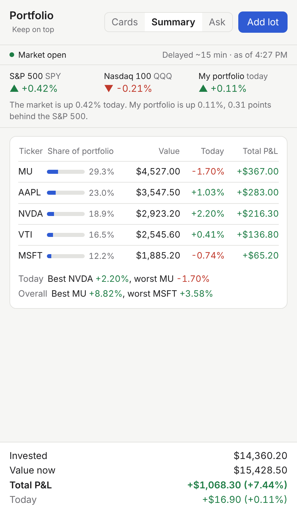
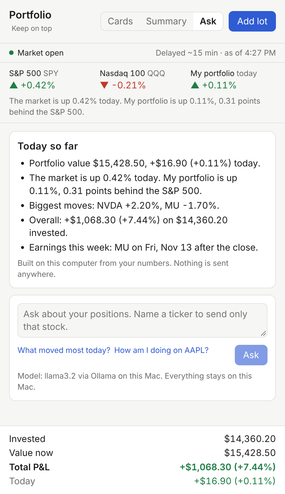
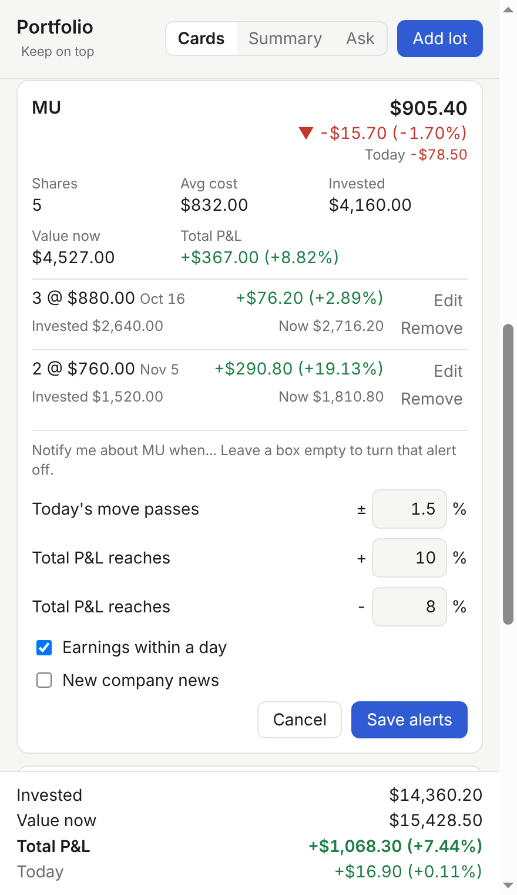

# Portfolio Widget

A small desktop widget that shows my stock positions and how they are doing, without opening my brokerage app. I enter my trades by hand, and the widget tracks each purchase separately, combines them per stock, and shows profit and loss for every purchase, every stock and the whole portfolio.

Built with Electron, React and TypeScript. My data stays on my machine.

<p align="center"></p>

| Cards | Summary | Ask | Alerts |
| --- | --- | --- | --- |
|  |  |  |  |

The screenshots use made-up positions and sample prices, not my real portfolio.

## What it does

- **Lots.** I add, edit and delete purchases (ticker, shares, buy price per share, date). Fractional shares are fine.
- **Cards.** One card per stock: price, today's move with an up or down arrow, shares, average cost, amount invested, value now and total P&L. Every purchase shows what I put in, what it is worth now and its own P&L.
- **Totals.** The footer shows the whole portfolio: invested, value now, total P&L and today's change.
- **Live prices.** Prices come from Finnhub, refresh every minute while the market is open, and are labeled as delayed with the time of the latest price. When the market is closed, the app says so and shows the last price.
- **Market strip.** Today's move for the S&P 500 and Nasdaq 100 next to my portfolio's, with one sentence comparing them.
- **Summary view.** Every stock in one table: share of the portfolio, value, today's move and total P&L, plus the best and worst performers today and overall.
- **Alerts.** Desktop notifications I set per stock: today's move passing a percentage, total P&L reaching a gain target or a loss limit, earnings within a day, and new company news. Nothing else notifies me.
- **Ask view.** A short digest of the day, built on my machine from my own numbers. Below it, a box for plain questions like "How am I doing on MU?" or "What moved most today?". A local model answers through Ollama, or Claude if I add an Anthropic key.
- **Widget.** A compact window that can stay on top of other windows and reopens where I left it. Only one copy runs at a time.

## Running it

You need Node.js 22 or newer, and a free API key from [finnhub.io](https://finnhub.io).

Put the key in a file called `.env` in the project folder:

```
FINNHUB_API_KEY=your_key_here
```

`.gitignore` excludes `.env`, so the key never reaches the repo.

For the Ask view, either install [Ollama](https://ollama.com) and run `ollama pull llama3.2`, or add an Anthropic key to the same `.env` file to use Claude instead:

```
ANTHROPIC_API_KEY=your_anthropic_key
```

Optional settings in `.env`: `OLLAMA_MODEL` (default `llama3.2`) and `ANTHROPIC_MODEL` (default `claude-haiku-5-5`). The digest works without either model.

Then:

```bash
npm install
npm run dev      # development: the window reloads when renderer code changes
npm start        # builds everything and runs the built app
```

Changes to `src/main` or `src/preload` need `npm run dev` to be restarted. Closing the window quits the app on every platform, including macOS.

## Building the Mac app

```bash
npm run dist
```

This builds the code and packages it with [electron-builder](https://www.electron.build) into `release/`, as a `.dmg` with `Portfolio Widget.app` inside. Drag the app into Applications and open it like any other app. Run this on a Mac; macOS apps cannot be packaged on other systems.

**API keys for the packaged app.** The packaged app cannot see the project folder, so it reads `.env` from its data folder instead. Copy the file there once:

```bash
cp .env ~/Library/Application\ Support/portfolio-widget/.env
```

If the key is missing, the app says so and shows the exact path where it looks. The same file can hold the Anthropic key.

**My lots carry over.** The development version and the packaged app use the same data folder, `~/Library/Application Support/portfolio-widget/`, so anything I entered with `npm run dev` shows up in the app, and the other way round.

**First launch.** The app is not signed with an Apple developer certificate, so there is no auto-updater and macOS may warn about it. An app I built on my own Mac usually opens normally. If macOS blocks it, right-click the app and choose Open, or allow it in System Settings, Privacy & Security, Open Anyway. If it says the app "is damaged", that is the same check, and this clears it:

```bash
xattr -cr "/Applications/Portfolio Widget.app"
```

The package only contains the built code (`dist/`, `dist-electron/` and `package.json`). React and the other libraries are bundled into the built files, so all packages are dev dependencies and no `node_modules` folder is shipped. Keys, tests and source files are not included.

## Tests

```bash
npm test             # runs every test once
npm run test:watch   # re-runs tests on save
npm run typecheck
```

The tests cover:

- the P&L math, including the two-lot Micron case below (`src/shared/pnl.test.ts`)
- lot validation (`src/shared/validateLot.test.ts`)
- the file store: saving, reloading, concurrent saves, failed saves, unreadable files and upgrading old files (`src/main/store.test.ts`, `src/main/migrate.test.ts`)
- quote parsing, including Finnhub's all-zero answer for unknown tickers, and how HTTP errors are reported (`src/main/finnhub.test.ts`)
- when prices are refreshed, open versus closed market, new tickers, unavailable tickers and failed refreshes (`src/main/quoteService.test.ts`)
- regular trading hours across daylight saving time (`src/shared/marketHours.test.ts`)
- portfolio weights, best and worst performers, and the sentence that compares my day with the market's (`src/shared/summary.test.ts`)
- reading keys and settings from `.env` (`src/main/envSettings.test.ts`)
- alert thresholds: crossing, not repeating, re-arming targets, starting fresh each trading day, earnings timing and news de-duplication (`src/main/alerts.test.ts`), the service that runs them and survives restarts (`src/main/alertService.test.ts`), and alert settings validation (`src/shared/validateAlerts.test.ts`)
- the two model providers, including the messages when Ollama is not running or a key is wrong (`src/main/chatModels.test.ts`)
- which data goes with a question, the digest, and the copilot that ties them together (`src/main/copilot.test.ts`)
- restoring the window position only when it is still on a screen (`src/main/windowState.test.ts`)

The tests never call Finnhub, Ollama or Anthropic. They use fake responses shaped like the real ones.

## How the P&L math works

Each purchase is a **lot**. A **position** is all the lots for one ticker. Positions are never stored; they are rebuilt from the lots every time, so there is only one source of truth.

| Number | Formula |
| --- | --- |
| Lot P&L | (current price - buy price) x shares |
| Position P&L | sum of its lots' P&L |
| Portfolio P&L | sum of every position's P&L |
| Average cost | total paid / total shares, so bigger lots count for more |
| P&L % | P&L / what was paid |

Example: I buy one Micron share at $950 yesterday and another at $850 today. Micron is now at $900.

| Lot | Bought | P&L |
| --- | --- | --- |
| 1 share at $950 | yesterday | (900 - 950) x 1 = -$50 |
| 1 share at $850 | today | (900 - 850) x 1 = +$50 |
| Position: 2 shares, average cost $900 | | $0 |

**Day change.** Day change is measured against the previous close, with one exception. A lot bought today did not exist at yesterday's close, so it is measured from its buy price instead.

In the example, Micron closed at $920 yesterday. The first lot is down $20 today (900 - 920). The second lot is up $50 (900 - 850). The position is up $30 for the day. If I measured both lots from the previous close, it would show -$40, a loss I never had.

I record only the date of each purchase, not the time. The date is all the day-change rule needs: a lot counts as "bought today" when its date matches the trading day of the quote. That trading day is the quote's date in New York, because that is the market's clock, so a quote at 7 PM Eastern still belongs to that day even though it is already tomorrow in UTC.

Dates are stored as plain `YYYY-MM-DD` text with no time zone, so "Nov 5" stays Nov 5 wherever the computer is. Lots bought on the same day are listed in the order I added them.

All math runs at full precision; values are rounded to cents only when they are displayed. The functions in `src/shared/pnl.ts` are pure (no network, no files, no clock), which is what makes them easy to test.

## How prices work

Prices come from Finnhub's free plan, which I treat as about 15 minutes behind. The window always says "Delayed ~15 min" next to the time of the newest price.

- **Refreshing.** Every 60 seconds the app asks Finnhub whether the US market is open (`/stock/market-status`). While it is open, every ticker I hold is re-quoted (`/quote`).
- **Closed market.** While the market is closed, prices cannot change, so the app stops re-quoting. It makes one last round right after the close to pick up closing prices. The status line then says "Market closed" and shows the time of the last price.
- **New tickers.** A ticker I just added is quoted immediately, open or closed.
- **No price.** For a ticker Finnhub does not know, it answers with all zeros, not an error. The app reads that as "no price" and says so on the card, as it does when the free plan does not cover a ticker. Those positions show their cost but are left out of the P&L totals, and the footer lists them.
- **Failures.** If a refresh fails (no internet, rate limit, bad key), the last good prices stay on screen and the status line says what went wrong and how old the prices are.
- **Fallback.** If Finnhub cannot tell me whether the market is open, I fall back to regular trading hours (9:30 AM to 4:00 PM New York time, weekdays) and the status line says "Market likely open" or "Market likely closed", because that guess does not know about holidays.

**The market strip.** Finnhub's free plan does not include the indexes themselves, so I use the funds that track them: SPY for the S&P 500 and QQQ for the Nasdaq 100. The strip labels them with both names. Their move is (price - previous close) / previous close. "My portfolio" is the same day change the footer shows, measured against the value my positions had at the start of the day. The sentence under the strip compares the two in percentage points, rounded the way they are displayed so the sentence always agrees with the numbers above it. After a weekend or holiday the latest prices are from an earlier session, so the strip says "on Fri" instead of "today".

**The Summary view.** Each position's share is its value divided by the total value of the positions that have a price. Best and worst are picked by percentage, not dollars, so a small position that doubled is not hidden behind a large one that moved a little. My choice of view is remembered in the window's local storage, since it is only a display preference.

The free plan's limit is 60 calls a minute. Each refresh uses one status call, one call per ticker, and two for SPY and QQQ, so this works for up to about 55 tickers.

## How alerts work

Each card has an Alerts line with a Change button. Leaving a box empty turns that alert off. New tickers start with only the earnings alert on, which is rare and useful; everything else is opt in.

| Alert | Fires when | Announced |
| --- | --- | --- |
| Today's move | the position's day change passes +X% or -X% | once per direction per trading day |
| Gain target | total P&L reaches +X% | once, then again only after it drops at least 1 point below the target and comes back |
| Loss limit | total P&L reaches -X% | once, re-armed the same way |
| Earnings | Finnhub's calendar shows earnings today or tomorrow | once per earnings date |
| News | Finnhub has headlines I have not been told about | at most one notification per stock per check, with the newest headline |

The targets report facts, like "MU is up 20.4% overall. You set a gain target at 20%." They do not tell me to buy or sell; that decision stays mine.

The 1-point gap before a target re-arms is there because a price sitting right on the line would otherwise notify me every minute.

Price alerts are checked every time prices refresh. Earnings and news need their own Finnhub calls, so they are checked every 15 minutes: each stock's earnings calendar at most once a day, and news only for stocks with news alerts on. Changing a setting runs the checks right away.

The decisions are pure functions in `src/main/alerts.ts`: given the latest numbers and a record of what was already announced, they return the notifications to show and the updated record. That record is saved to `alert-memory.json` next to my data, so restarting the app does not repeat an alert.

## How the Ask view works

**The digest** sits at the top: a few lines on today's value and change, how that compares with the S&P 500, the biggest moves, overall P&L, earnings in the next week, and any stock without a price. Its title follows the market clock: "Morning digest" before the open, "Today so far" while trading, "Today's close" after. It is built on my machine from my own numbers (`src/main/digest.ts`), with no model involved, so it never sends anything anywhere.

**Questions** go through one small interface in the main process (`src/main/chatModels.ts`) with two providers behind it:

| | Ollama (default) | Claude (when `ANTHROPIC_API_KEY` is set) |
| --- | --- | --- |
| Runs | on my Mac, at `127.0.0.1:11434` | Anthropic's API |
| My data | never leaves the machine | sent with each question |
| If unavailable | a plain message saying how to install it or pull the model | a plain message about the key or the connection |

The window shows which model is active, and whether my data stays on the Mac.

**What gets sent, and when.** The window only sends my question. The main process adds the data, and only when I ask:

- If the question names tickers I hold ("how am I doing on mu?"), only those positions are sent, with each lot.
- Otherwise a one-line summary of each position is sent, which is what questions like "what moved most today?" need.
- The market move and the time of the prices go with either.

Nothing else is sent: no file paths, no keys, no alert settings. Under each answer, "What was sent" shows exactly that text. Tickers are matched as whole words, so "mutual" does not match MU. Company names are not matched, so "Micron" sends the general summary instead of MU alone.

The system prompt tells the model to use only that data, say so when the answer is not in it, and describe the numbers without telling me to buy or sell.

## Storage and privacy

Everything lives in the app's data folder, the same one for `npm run dev` and the packaged app:

- macOS: `~/Library/Application Support/portfolio-widget/`
- Windows: `%APPDATA%\portfolio-widget\`
- Linux: `~/.config/portfolio-widget/`

| File | Holds |
| --- | --- |
| `portfolio.json` | my lots and alert settings |
| `alert-memory.json` | which alerts were already shown, so they are not repeated |
| `window.json` | window size, position and whether it stays on top |
| `.env` | API keys, for the packaged app (while developing, the project folder's `.env` is read first) |

Nothing is stored in the project folder. Network traffic is limited to Finnhub requests (quotes, market status, earnings and news), which carry ticker symbols and nothing about my positions, plus questions I ask in the Ask view. Those go to Ollama on my own machine, or to Anthropic only if I have added an Anthropic key.

**How saving works:**

- Every save writes a temporary file next to `portfolio.json`, flushes it to disk, and renames it over the old file. A rename in the same folder is atomic, so after a crash the file is either the old version or the new one.
- Saves go through a queue, so two quick edits cannot overwrite each other.
- The in-memory copy is updated only after the file is written, so a failed save never shows data that was not saved.
- If the file cannot be read (for example after a manual edit went wrong), it is renamed to `portfolio.json.unreadable-<time>` instead of being overwritten, and the app starts empty.
- The file has a `version` number. When the format changes, the app upgrades older files on startup and first saves a copy as `portfolio.json.v<old version>-backup`. Version 1 stored a full purchase timestamp; version 2 stores only the date, using the date the timestamp showed on my computer; version 3 adds alert settings per stock.

Keys are read from `.env` (or environment variables of the same names) by the main process only. Each is sent in a request header rather than in the URL, so it never appears in addresses or error messages.

## How the app is put together

Electron runs two kinds of process. The main process has full Node.js access. The renderer is the web page I see. I keep the page locked down:

- **Context isolation, sandbox, and no Node.js in the page.** The page cannot reach the file system, environment variables or the API key.
- **One narrow bridge.** The preload script exposes a small set of functions on `window.portfolio` (see `PortfolioApi` in `src/shared/types.ts`): lots, quotes, alert settings, the copilot, the digest, app info and keep-on-top. Each one but `onQuotes` sends an IPC message to the main process; `onQuotes` receives the price updates the main process pushes after each refresh. Only the price data is passed to the page, never Electron's IPC event object.
- **The main process checks everything.** It re-validates every lot and alert setting that comes over IPC, even though the form already checked it, and it only answers messages from the app's own page.
- **The page loads nothing from outside.** The built page has a Content Security Policy that only allows the app's own files. It cannot navigate away or open new windows.

```
src/
  main/       Electron main process: window, IPC handlers, file storage, Finnhub client, price refresh, alerts, copilot and digest
  preload/    the bridge between the page and the main process
  renderer/   React UI
  shared/     types, P&L math, validation and trading hours used by both sides
scripts/
  dev.mjs     starts Vite and Electron together for development
  clean.mjs   empties a build folder before rebuilding
docs/         screenshots and the demo GIF for this README
```

The window remembers its size and position in `window.json`. If the saved position is no longer on any screen, for example after unplugging a monitor, it opens in the default spot instead. That save happens synchronously while the app quits, because an asynchronous write can be cut off before it finishes.
